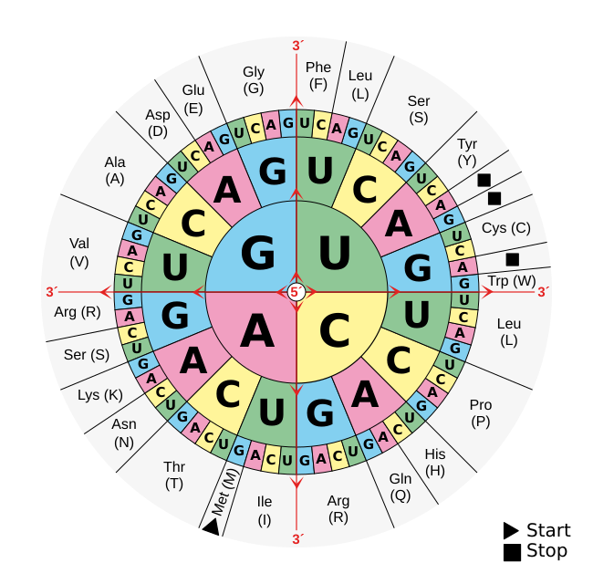

The program translates mRNA codons (sequences of three consecutive nucleotides) into the corresponding amino acid sequence based on the genetic code, reading from `codons.txt` and writing the result to `proteins.txt`.  

*Code features:*
* INPUT validity control: Checks for invalid characters, incomplete codons, missing input, starting codon, and stop codon.  
* File-based I/O: Reads nucleotide characters from `codons.txt` (ignoring spaces and newlines) and outputs the translated sequence or status messages to `proteins.txt`.  

*Notes: The program notify only syntax error of the input sequence, such as the presence of invalid character, but the logic error, like missing starting codon, are notified trough the output file*

###### open source is love <3
###### README.md made with [Markdown Live Preview](https://markdownlivepreview.com/)
